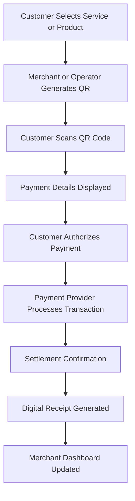
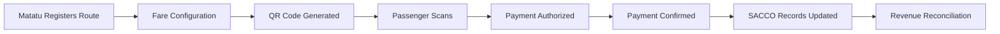
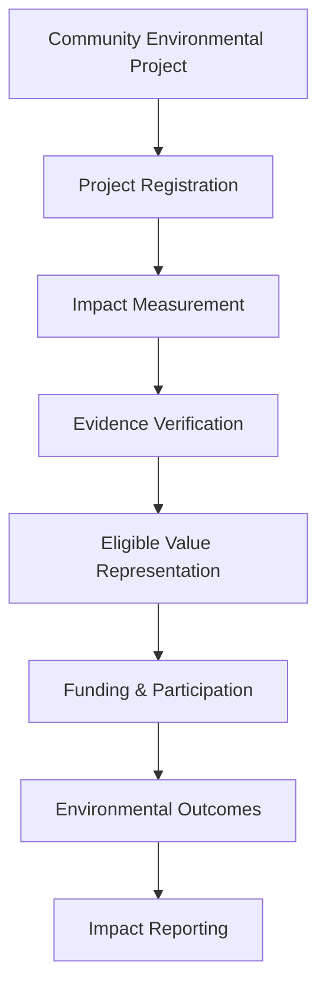

# 🇰🇪 NAKURU INNOVATION
## Kenya's Digital Trade Capital

### Transforming Payments. Empowering Communities. Building Africa's Smart-Finance Future.

  <strong>START LOCAL. CONNECT COMMUNITIES. SCALE ACROSS AFRICA.</strong>
   
  <em>From matatus to markets, farmers to fintech — building an interconnected digital economy for Nakuru and beyond.</em>

  <a href="#-vision">Vision</a> •
  <a href="#-qr-payment-infrastructure">QR Payments</a> •
  <a href="#-ecosystem">Ecosystem</a> •
  <a href="#-innovation">Innovation</a> •
  <a href="#-roadmap">Roadmap</a> •
  <a href="#-contributing">Contributing</a>

---

## 🌍 01. Our Vision

Nakuru is an important center of commerce, agriculture, education, transportation, and entrepreneurship in Kenya.

Yet many local economic activities still depend on fragmented financial infrastructure, manual processes, limited access to digital services, and disconnected information systems.

What if a farmer could receive an instant digital payment at the market?

What if a matatu passenger could pay digitally without carrying cash?

What if a small merchant could access financial protection, digital records, and new customers through one platform?

What if county services, educational institutions, healthcare providers, and local businesses could participate in one connected digital economy?

**Nakuru Innovation** is envisioned as an integrated digital commerce and smart-finance ecosystem designed to make these possibilities accessible.

Our mission is to connect payments, businesses, communities, institutions, and innovation into a shared digital infrastructure.

We aim to create an ecosystem where:

- Every merchant can participate in digital commerce.
- Farmers can access convenient digital payment systems.
- Public transport operators can manage transparent fare collection.
- Communities can access financial and digital services.
- Small businesses can participate in broader economic networks.
- Young innovators can build solutions for local challenges.
- Regenerative projects can connect with digital finance.
- Local innovation can become a foundation for African economic growth.

**Our philosophy: Digital transformation should not leave local communities behind.**

---

# 💳 02. QR Payment Infrastructure
## Simple. Fast. Secure.

QR Payment Rails are the foundational financial interface of Nakuru Innovation.

The platform explores QR-based payments that simplify financial transactions across markets, transport networks, retail businesses, and community services.

### Core Capabilities

- QR-based payment initiation.
- Merchant payment identification.
- Transaction confirmation.
- Payment records.
- Digital receipts.
- Merchant transaction dashboards.
- Payment analytics.
- Loyalty and reward integrations.
- Mobile-first payment experiences.

### Designed for Everyday Commerce

| User | Payment Application |
|---|---|
| Farmers | Receive payments for agricultural products |
| Market Traders | Accept digital customer payments |
| Matatu Operators | Collect digital passenger fares |
| Retail Merchants | Accept QR-based purchases |
| Customers | Pay through supported mobile payment applications |
| Institutions | Collect eligible service payments |

### QR Payment Workflow

### Payment Design Principles

- Clear transaction amounts.
- Transparent service fees.
- Reliable payment confirmation.
- Secure transaction references.
- Accessible mobile interfaces.
- Appropriate transaction reconciliation.
- Support for multiple merchant environments.

Actual settlement, payment confirmation, and QR interoperability depend on integration with supported payment providers and their APIs. A generated QR code alone does not constitute a completed payment.

---

# 🛡️ 03. SecureFuture Micro-Insurance
## Financial Protection Within Everyday Transactions

SecureFuture is the proposed embedded protection component of the Nakuru Innovation ecosystem.

Its vision is to explore ways of connecting suitable micro-insurance products with everyday economic activity.

### Potential Capabilities

- Embedded protection offerings.
- Accessible insurance information.
- Digital policy records.
- Premium payment integration.
- Claims submission.
- Claims status tracking.
- Merchant and customer protection options.
- Insurance awareness and education.

### Example Applications

| Ecosystem | Potential Protection |
|---|---|
| Agriculture | Eligible crop and farm-related insurance |
| Public Transport | Appropriate vehicle and passenger protection |
| Retail | Eligible merchant protection |
| Households | Relevant personal protection products |
| Small Businesses | Business-related insurance solutions |

Insurance products, pricing, underwriting, distribution, and claims must be provided through appropriately authorized insurance partners and comply with applicable Kenyan requirements.

---

# 🏪 04. Empowering Local Markets
## Digital Commerce for Nakuru's Informal Economy

Nakuru's markets are important centers of trade, entrepreneurship, agriculture, and community interaction.

Nakuru Innovation aims to support their digital transformation without sacrificing the accessibility and human relationships that make local commerce thrive.

### Initial Market Focus: Wakulima Market

Potential capabilities include:

- QR-based merchant payments.
- Digital transaction records.
- Payment confirmation.
- Merchant profiles.
- Loyalty rewards.
- Digital business summaries.
- Financial service integrations.
- Merchant network discovery.

### Benefits for Farmers

- Convenient digital payment collection.
- Improved transaction visibility.
- Reduced dependence on cash.
- Better financial recordkeeping.
- Potential access to digital financial services.

### Benefits for Customers

- Convenient transactions.
- Clear payment information.
- Digital receipts.
- Easier payment reconciliation.
- Potential loyalty rewards.

### Market Network

The Market Network is envisioned as a connected environment bringing together:

- Farmers.
- Traders.
- Buyers.
- Wholesalers.
- Retail merchants.
- Agricultural suppliers.
- Delivery providers.
- Financial service partners.

**Our ambition is to transform the local market into a connected digital marketplace.**

---

# 🚌 05. Smart Transport Solutions
## Digitizing Matatu Mobility

Public transportation is central to everyday life in Nakuru.

Nakuru Innovation explores QR-powered fare collection and digital transport administration for matatu operators and Savings and Credit Cooperative Organizations (SACCOs).

### Core Capabilities

**QR Fare Collection**
- Route-based fare configuration.
- Digital fare initiation.
- Transaction confirmation.
- Passenger payment records.

**SACCO Management**
- Digital revenue records.
- Automated allocation workflows.
- Route and vehicle analytics.
- Transaction reconciliation.
- Operator dashboards.

**Passenger Experience**
- Mobile-friendly payment flows.
- Fare visibility.
- Digital payment receipts.
- Convenient payment access.

### Transport Payment Workflow

### Benefits

- Improved transaction transparency.
- Better financial reporting.
- Easier reconciliation.
- Reduced manual cash administration.
- Potentially improved passenger experience.
- Better operational analytics.

The platform should support flexible cash and digital payment options during adoption. It should also account for offline conditions, network reliability, and accessible alternatives.

---

# 🏛️ 06. Complete Fintech Ecosystem
## Beyond Payments

Nakuru Innovation aims to become more than a payment application.

It is designed as a connected ecosystem serving commerce, public services, education, healthcare, sustainability, and community development.

### I. QR Payment Rails

The financial transaction layer connecting merchants, customers, businesses, and service providers.

### II. Micro-Insurance

Embedded access to appropriate protection products through authorized partners.

### III. Community First

A locally responsive ecosystem designed for Nakuru's diverse communities.

### IV. Innovation Labs

A technology development environment focused on youth innovation, research, and practical problem-solving.

### V. Instant Settlements

An architecture designed to support timely payment confirmation, settlement tracking, and transparent reconciliation through integrated providers.

### VI. Mobile First

A responsive experience designed for accessibility across smartphones and supported devices.

---

# 🎓 07. Education Hub
## Empowering the Next Generation of African Innovators

The Education Hub connects technology, entrepreneurship, research, and practical skills development.

The supplied concept identifies collaboration opportunities with Egerton University and TVET institutions.

### Potential Programs

**Developer Training**
- Software development.
- Mobile application development.
- Fintech engineering.
- AI and machine learning.
- Cybersecurity.
- API development.

**Innovation Labs**
- Student innovation projects.
- Applied technology research.
- Startup incubation.
- Hackathons.
- Community technology challenges.

**Academic Collaboration**
- Research projects.
- Applied innovation programs.
- Technology demonstrations.
- Industry mentorship.
- Research funding opportunities.

**Future Skills**
- Digital financial literacy.
- Entrepreneurship.
- Data science.
- Digital business operations.
- Sustainable technology.

The Egerton University collaboration should be presented as a confirmed partnership only when formally established.

---

# 🏥 08. Healthcare & AEGIS Intelligence

Healthcare is an important pillar of the wider Nakuru Innovation ecosystem.

The proposed AEGIS component introduces a digital intelligence environment for community health insights and healthcare service integration.

### Potential Capabilities

- Clinic payment integration.
- Healthcare service directories.
- Appointment-related workflows.
- Aggregate health metrics.
- Emergency response coordination.
- Insurance claims integrations.
- Community health reporting.

### AEGIS Intelligence

AEGIS is envisioned as an analytical support layer for understanding community health trends and service accessibility.

Potential applications include:
- Aggregated health indicators.
- Healthcare resource availability.
- Public health insights.
- Service delivery analytics.
- Emergency response visibility.

Health data is particularly sensitive. Any AEGIS deployment must apply strong confidentiality, access controls, data minimization, and appropriate health-data governance. Aggregated reporting should not expose identifiable patient records.

---

# 🌱 09. Sustainability & Atlas Sanctum Integration
## Regenerative Value Exchange

Nakuru Innovation connects with the broader Atlas Sanctum vision through Regenerative Value Exchange (RVE).

The objective is to explore how digital financial infrastructure can support measurable environmental and community development initiatives.

### Potential Applications

**Carbon and Environmental Projects**
- Eligible carbon-related project records.
- Environmental monitoring.
- Restoration project tracking.
- Impact reporting.

**Green Investments**
- Regenerative project discovery.
- Sustainable business development.
- Funding opportunities.
- Environmental project analytics.

**Community Rewards**
- Sustainability participation.
- Local environmental initiatives.
- Community development projects.
- Responsible reward programs.

### Example Regenerative Workflow

RVE is a proposed ecosystem integration. Carbon credits and other environmental assets require appropriate methodologies, independent verification, legal recognition, and transparent ownership records. Tokenization alone does not create environmental additionality or establish a valid carbon credit.

---

# 🏙️ 10. County Services
## Bringing Public Services Into the Digital Economy

Nakuru Innovation explores opportunities to simplify eligible county-related transactions through digital payment integrations.

### Potential Service Categories

- Property rates.
- Business permits.
- Water bills.
- Parking fees.
- Other eligible municipal services.

### Capabilities

- Digital payment initiation.
- Payment references.
- Receipt management.
- Transaction records.
- Service payment dashboards.
- Reconciliation support.

These services require formal integration with relevant county systems and authorization from the responsible institutions.

---

# 📊 11. Community Adoption
## Digital Transformation Starts Locally

Nakuru Innovation is built around community participation.

Rather than treating adoption as a purely technological challenge, the platform recognizes the importance of trust, accessibility, local partnerships, and education.

### Demonstration Adoption Dashboard

The supplied interface displays the following neighborhood indicators:

| Area | Displayed Adoption | Population Figure |
|---|---:|---:|
| London Estate | 78% | 15K+ |
| Free Area | 65% | 12K+ |
| CBD Central | 82% | 8K+ |
| Wakulima Market | 91% | 5K+ |

These are illustrative interface figures, not independently verified adoption statistics or population estimates.

### Community Adoption Strategy

**Awareness**
Introduce local merchants, transport operators, and residents to digital payment opportunities.

**Education**
Provide demonstrations, practical guidance, and digital literacy support.

**Participation**
Involve local businesses and community representatives in platform development.

**Trust**
Make transaction costs, payment status, data practices, and customer support transparent.

**Expansion**
Build repeatable adoption models that can extend to additional neighborhoods and commercial networks.

---

# 🧠 12. Innovation Labs
## Building With Nakuru's Next Generation

Innovation Labs provide an environment for young developers, students, researchers, and entrepreneurs to create solutions for local economic and social challenges.

### Innovation Focus Areas

- Financial technology.
- Artificial intelligence.
- Agricultural technology.
- Smart transportation.
- Healthcare technology.
- Environmental technology.
- Digital public services.
- Cybersecurity.
- Data science.
- Entrepreneurship.

### Youth Innovation Programs

Potential initiatives include:

- Student developer programs.
- Community hackathons.
- Startup development.
- Applied research.
- Mentorship programs.
- University collaboration.
- Local innovation challenges.

**Our ambition is to make Nakuru a place where young people do not just consume technology — they build it.**

---

# 🗺️ 13. From Nakuru to Africa
## A Scalable African Digital Economy

Nakuru Innovation follows a phased regional expansion strategy.

The principle is straightforward:

**Start local. Prove value. Build trust. Scale responsibly.**

### Phase I — Nakuru

Establish the foundational ecosystem through:

- QR payments.
- Market digitization.
- Matatu payment integrations.
- Merchant onboarding.
- Community engagement.
- Local innovation programs.

### Phase II — Countywide Expansion

Expand into:

- Additional markets.
- Retail networks.
- Transport SACCOs.
- Educational institutions.
- Healthcare providers.
- Public service integrations.
- Agricultural value chains.

### Phase III — National Expansion

Develop partnerships and integrations across Kenya.

Potential focus areas:
- County digital commerce networks.
- Interoperable payment experiences.
- National merchant services.
- Agricultural financial inclusion.
- Digital transport infrastructure.
- Youth innovation networks.

### Phase IV — African Expansion

Explore regional deployment through partnerships and interoperable infrastructure.

Potential markets can be selected based on:
- Local payment ecosystems.
- Merchant demand.
- Transport requirements.
- Regulatory frameworks.
- Institutional partnerships.
- Community adoption readiness.

### Expansion Philosophy

If the model creates measurable value in Nakuru's markets, matatus, and farms, it can provide a foundation for adapting similar solutions to other African communities.

---

# 🏗️ 14. Technical Architecture

Nakuru Innovation requires a modular architecture capable of supporting digital payments, merchant operations, financial integrations, and broader community services.

### Conceptual Platform Architecture

```mermaid id="nk7m42"
flowchart TB
    A["NAKURU INNOVATION PLATFORM"]

    A --> B["User Experience Layer"]
    A --> C["Commerce & Payment Layer"]
    A --> D["Ecosystem Services"]
    A --> E["Intelligence Layer"]
    A --> F["Integration Layer"]

    B --> B1["Customer App"]
    B --> B2["Merchant Portal"]
    B --> B3["Transport Interface"]
    B --> B4["Community Portal"]

    C --> C1["QR Payment Engine"]
    C --> C2["Transaction Records"]
    C --> C3["Settlement & Reconciliation"]
    C --> C4["Loyalty Services"]

    D --> D1["Micro-Insurance"]
    D --> D2["Education Hub"]
    D --> D3["Healthcare & AEGIS"]
    D --> D4["Sustainability & RVE"]

    E --> E1["Transaction Analytics"]
    E --> E2["Merchant Intelligence"]
    E --> E3["Community Analytics"]
    E --> E4["Impact Reporting"]

    F --> F1["Payment Providers"]
    F --> F2["Financial Partners"]
    F --> F3["County Systems"]
    F --> F4["External APIs"]

    C --> G["Shared Platform Infrastructure"]
    D --> G
    E --> G
    F --> G
```

### Engineering Priorities

- Modular service architecture.
- Secure transaction processing.
- Reliable payment integrations.
- Merchant identity management.
- Role-based access control.
- Payment reconciliation.
- Mobile-first interfaces.
- API interoperability.
- Operational observability.
- Data security and privacy.
- Scalable merchant infrastructure.

The actual programming languages, frameworks, databases, payment providers, and hosting infrastructure should be documented according to the implemented repository.

---

# 🔐 15. Security, Trust & Compliance

Financial infrastructure requires a high level of security and operational discipline.

Nakuru Innovation aims to establish the following development principles:

### Transaction Security
- Secure API communication.
- Transaction integrity.
- Payment authorization.
- Duplicate transaction protection.
- Audit trails.
- Reconciliation controls.

### Identity and Access
- Secure authentication.
- Appropriate merchant verification.
- Role-based permissions.
- Administrative access controls.
- Account protection.

### Data Protection
- Data minimization.
- Encryption in transit and at rest.
- Privacy-aware analytics.
- Retention policies.
- Access monitoring.
- Incident response procedures.

### Financial Responsibility

Production payment services, insurance distribution, digital financial products, and any regulated financial activities must be delivered through appropriately authorized providers and in accordance with applicable Kenyan laws and regulatory requirements.

---

# 📱 16. Platform Features

The platform's core navigation includes:

| Module | Purpose |
|---|---|
| Home | Discover the Nakuru Innovation ecosystem |
| QR Payments | Initiate QR-based payments |
| Merchant Portal | Manage business payment activity |
| Ecosystem | Explore integrated digital services |
| Learn | Access learning resources |
| Community | Connect with local participants |
| Sign In | Access authorized platform services |
| Get Started | Begin onboarding |

### Merchant Portal

A dedicated interface for:
- Merchant profiles.
- QR payment management.
- Transaction histories.
- Settlement visibility.
- Business analytics.
- Customer engagement.

### Developer Tools

Infrastructure for:
- API documentation.
- Integration guidance.
- Payment workflows.
- Developer resources.
- Sandbox testing.

---

# 📈 17. Platform Vision & Demonstration Metrics

The supplied platform interface presents the following ecosystem overview:

| Indicator | Displayed Value |
|---|---:|
| Active Users | 10K+ |
| Merchants | 500+ |
| Support | 24/7 |

These figures describe the supplied interface, not independently verified platform usage.

For a production deployment, the metrics should be connected to reliable backend records and clearly defined measurement periods.

---

# 🧪 18. Development Roadmap

### Phase I — Digital Commerce Foundation

- [ ] Establish platform design system.
- [ ] Develop responsive homepage.
- [ ] Build QR payment interface.
- [ ] Implement QR generation workflows.
- [ ] Develop merchant profiles.
- [ ] Establish transaction data models.
- [ ] Design customer onboarding.

### Phase II — Payment Infrastructure

- [ ] Integrate supported payment providers.
- [ ] Implement payment authorization flows.
- [ ] Develop transaction verification.
- [ ] Build settlement and reconciliation workflows.
- [ ] Introduce digital receipts.
- [ ] Implement merchant analytics.

### Phase III — Market & Transport Digitization

- [ ] Develop merchant network management.
- [ ] Introduce market payment integrations.
- [ ] Build matatu fare collection workflows.
- [ ] Develop SACCO dashboards.
- [ ] Introduce transport analytics.
- [ ] Pilot community adoption programs.

### Phase IV — Financial & Institutional Ecosystem

- [ ] Develop SecureFuture partner integrations.
- [ ] Introduce eligible county service payments.
- [ ] Develop Education Hub.
- [ ] Establish AEGIS integration architecture.
- [ ] Expand institutional partnerships.

### Phase V — Regenerative Economy

- [ ] Integrate Atlas Sanctum RVE concepts.
- [ ] Develop environmental project records.
- [ ] Introduce impact measurement.
- [ ] Establish evidence verification.
- [ ] Explore eligible regenerative asset integrations.

### Phase VI — Regional Expansion

- [ ] Expand merchant onboarding.
- [ ] Support additional transport networks.
- [ ] Develop countywide digital commerce.
- [ ] Establish national partnerships.
- [ ] Explore additional African markets.

*Roadmap items describe intended development priorities, not confirmed completed deployments.*

---

# 🤝 19. Partnerships & Collaboration

Nakuru Innovation is intended to grow through collaboration with local communities and institutions.

### Potential Ecosystem Participants

- Market associations.
- Farmers and agricultural cooperatives.
- Matatu SACCOs.
- Retail merchants.
- Universities and TVET colleges.
- Financial institutions.
- Licensed payment providers.
- Insurance providers.
- County institutions.
- Healthcare organizations.
- Technology startups.
- Youth innovation communities.

### Partnership Opportunities

- QR payment adoption.
- Market digitalization.
- Public transportation technology.
- Financial inclusion.
- Youth developer training.
- Applied technology research.
- Digital health services.
- Sustainable development projects.

Institutional partnerships should be listed as confirmed only after formal agreements have been established.

---

# 🌍 20. Our Impact Philosophy

We believe technology should create tangible benefits for the communities using it.

A payment system should make commerce easier.

A transport platform should improve transparency and accountability.

An education platform should unlock opportunity.

A healthcare system should support better service delivery.

A regenerative economy should reward activities that create measurable ecological and social value.

The success of Nakuru Innovation should ultimately be measured by improvements in:

- Financial inclusion.
- Merchant productivity.
- Payment accessibility.
- Transportation transparency.
- Digital literacy.
- Youth employment and innovation.
- Institutional efficiency.
- Community participation.
- Environmental stewardship.

**Technology is not the destination. It is the infrastructure through which communities create a better future.**

---

# 🤝 21. Contributing

We welcome software developers, designers, entrepreneurs, researchers, students, merchants, and community innovators.

### Contribution Areas

- Frontend development.
- Backend engineering.
- QR payment integrations.
- Fintech infrastructure.
- Mobile application development.
- API engineering.
- Cybersecurity.
- AI and data analytics.
- Agricultural technology.
- Transport technology.
- Community innovation.
- Sustainability technology.

### Contribution Workflow

1. Explore the repository.
2. Review the existing documentation.
3. Identify an issue or improvement.
4. Discuss major architectural changes.
5. Submit a pull request with relevant tests and documentation.

Contribution guidelines will be published as the repository develops.

---

# 📞 22. Contact & Connect

**Nakuru Innovation**

Building Africa's smart-finance ecosystem, starting with Nakuru.

| Contact | Details |
|---|---|
| Location | Nakuru, Kenya |
| Phone | +254 700 000 000 |
| Email | hello@nakuruinnovation.co.ke |

*Confirm that the published telephone number and email address are active before production release.*

### Platform Resources

| Resource | Description |
|---|---|
| QR Payments | Payment initiation and merchant transactions |
| Merchant Portal | Merchant operations |
| API Documentation | Developer integrations |
| Developer Tools | Technical resources |
| County Services | Public service integrations |
| Education Hub | Learning and research |
| Healthcare | Digital health integrations |
| Sustainability | Regenerative value initiatives |
| Community | Local engagement |
| Innovation Labs | Youth innovation programs |

---

# 📜 23. License

The repository license has not yet been specified.

An appropriate license should be selected before publishing terms governing redistribution, modification, and public contributions.

---

# 🇰🇪 NAKURU INNOVATION

## Kenya's Digital Trade Capital.

**Transforming Payments. Empowering Communities. Building Africa's Smart-Finance Future.**

From the markets of Nakuru to the transport networks of Africa.

From local entrepreneurship to connected digital economies.

From everyday payments to regenerative prosperity.

We believe the future of African innovation begins by solving real problems for real people.

**Start in Nakuru. Build for Kenya. Design for Africa.**

  <strong>NAKURU INNOVATION</strong>
   
  <em>BUILT FOR COMMUNITIES. POWERED BY INNOVATION. DESIGNED FOR AFRICA.</em>
    
  🇰🇪 Nakuru, Kenya
    
  © 2024 Nakuru Innovation. All rights reserved.

